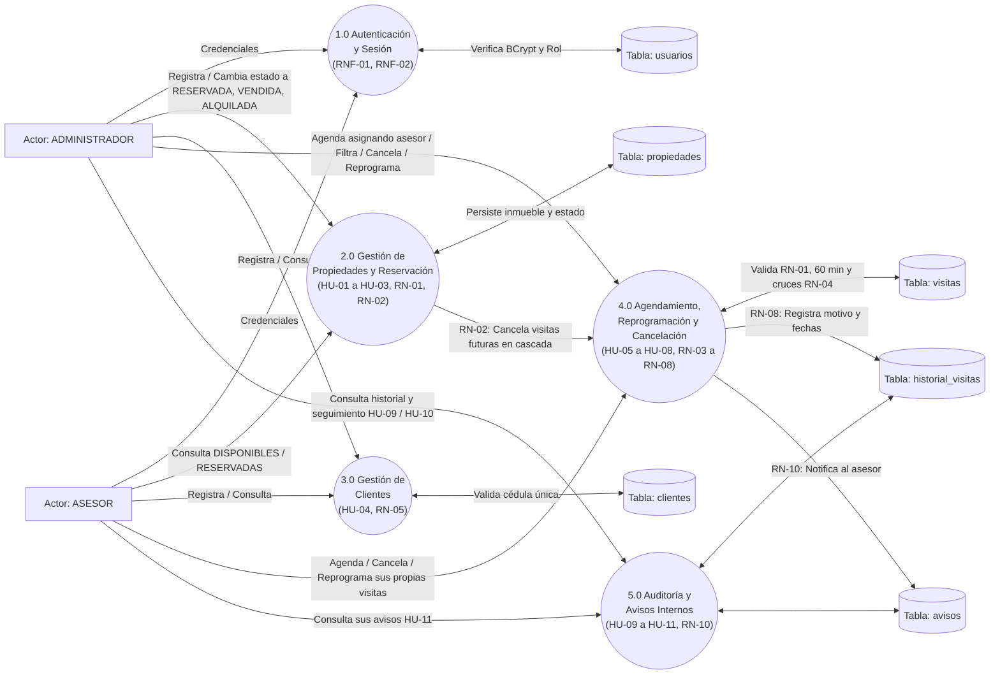
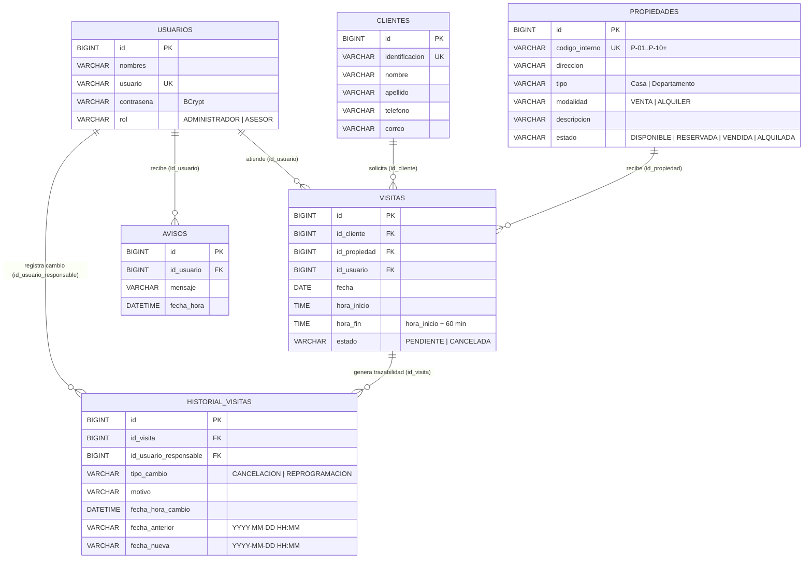
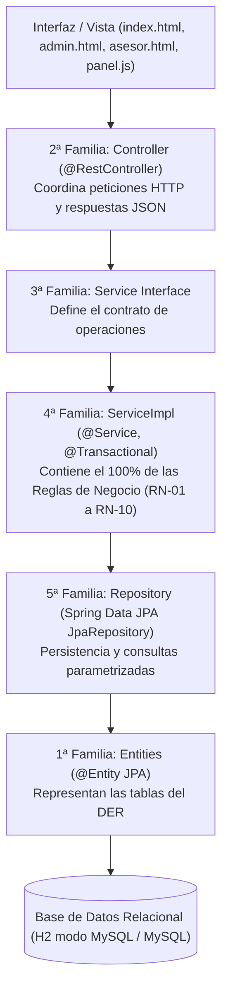
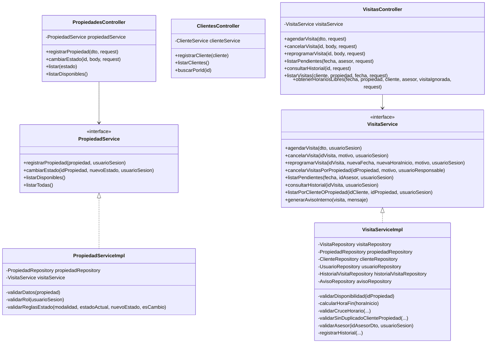

# Plan de Arquitectura, Modelos y Diseño (`02_PLAN.md`)

Este documento describe el **Plan de Diseño e Implementación** del **Sistema de Gestión Inmobiliaria**, estructurado bajo la metodología **SDD (Spec-Driven Development)** e integrando el **DFD**, el **DER**, la **Arquitectura por Capas** y el **Diagrama de Clases (5 Familias)** exigidos en la consigna del Proyecto Final del IST CENESTUR.

---

## 1. Conexión entre Modelos: DFD, DER y Clases

Siguiendo la regla de correlación del proyecto:
- **Los procesos del DFD** determinan las operaciones expuestas en los `Controller` y `Service`.
- **Las entidades del DER** se mapean 1 a 1 en la primera familia (`Entities` JPA en `com.inmobiliaria.model`).
- **Las Historias de Usuario (`HU`) y Requisitos Funcionales (`RF`)** definen los contratos en `Service`, y **las Reglas de Negocio (`RN-01` a `RN-10`)** se implementan exclusivamente en `ServiceImpl`.

### 1.1. Diagrama de Flujo de Datos (DFD - Nivel 1)

---

### 1.2. Diagrama Entidad-Relación (DER)

---

## 2. Arquitectura por Capas y Separación de Responsabilidades

### 2.1. Diagrama de Clases (Las 5 Familias del Diseño Aprobado)

---

## 3. Reglas Estrictas del Estado de Reservación (`RESERVADA`) y Reprogramación sin Duplicados

1. **Coherencia estricta `Modalidad` vs `EstadoPropiedad` (`PropiedadServiceImpl.validarReglasEstado`)**:
   - Una propiedad en modalidad `VENTA` solo admite los estados `DISPONIBLE`, `RESERVADA` o `VENDIDA` (se rechaza `ALQUILADA` con `400 Bad Request`).
   - Una propiedad en modalidad `ALQUILER` solo admite los estados `DISPONIBLE`, `RESERVADA` o `ALQUILADA` (se rechaza `VENDIDA` con `400 Bad Request`).
   - Una propiedad que ya figura como `VENDIDA` o `ALQUILADA` no puede pasar directamente a `RESERVADA` sin antes habilitarse como `DISPONIBLE`.
2. **Bloqueo y Cancelación en Cascada al pasar a `RESERVADA` (`RN-01` y `RN-02`)**:
   - Al marcar una propiedad como `RESERVADA`, todas sus visitas futuras en estado `PENDIENTE` se cancelan automáticamente con el motivo `"propiedad reservada"`, registrando el cambio en `HistorialVisita` y enviando un `Aviso` interno al asesor asignado.
   - Mientras esté `RESERVADA`, el sistema rechaza agendar o reprogramar visitas sobre ella (`RN-01`) y devuelve `0` horarios disponibles en `/api/visitas/horarios-libres`.
3. **Prevención de Duplicados y Experiencia de Usuario en Reprogramación (`VisitaServiceImpl` + `panel.js`)**:
   - El sistema impide que un mismo cliente registre más de una visita `PENDIENTE` simultánea para la misma propiedad (`validarSinDuplicadoClientePropiedad`).
   - El sistema impide reprogramar una visita hacia su misma fecha y hora actual, evitando entradas duplicadas en el historial y en los avisos.
   - En la interfaz web (`admin.html` y `asesor.html`), la tarjeta de reprogramación permanece oculta hasta que el usuario pulsa **"Reprogramar"**, deshabilita el botón durante el envío para evitar dobles clics y se cierra automáticamente al confirmarse el cambio, resaltando en verde la fila actualizada.
