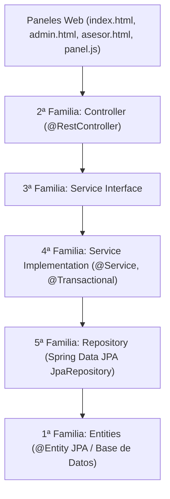

# Plan de Arquitectura e Implementación (`02_PLAN.md`)

Este documento describe el **Plan de Diseño e Implementación** del **Sistema de Gestión Inmobiliaria**, estructurado bajo la metodología **SDD (Spec-Driven Development)** y alineado con el diagrama de arquitectura de 5 familias de clases del PDF oficial (*Gestión Inmobiliaria - Grecco Cedeño y Britany Tahis Macias*).

---

## 1. Arquitectura General (Las 5 Familias de Clases)

### 1.1. Primera Familia: Entities (`com.inmobiliaria.model`)
- `Usuario`: `id`, `nombres`, `usuario` (único), `contrasena` (`WRITE_ONLY`, cifrada con BCrypt), `rol` (`ADMINISTRADOR` | `ASESOR`).
- `Propiedad`: `id`, `codigoInterno` (único, autogenerado `P-01`, `P-02`... o manual), `direccion`, `tipo` (`Casa` | `Departamento`), `modalidad` (`VENTA` | `ALQUILER`), `descripcion` (opcional), `estado` (`DISPONIBLE` | `RESERVADA` | `VENDIDA` | `ALQUILADA`).
- `Cliente`: `id`, `identificacion` (única), `nombre`, `apellido`, `telefono`, `correo` (opcional).
- `Visita`: `id`, relaciones `@ManyToOne` hacia `Cliente`, `Propiedad` y `Usuario` (asesor), `fecha` (`LocalDate`), `horaInicio` (`LocalTime`), `horaFin` (`LocalTime`), `estado` (`PENDIENTE` | `CANCELADA`).
- `HistorialVisita`: `id`, relaciones `@ManyToOne` hacia `Visita` y `Usuario`, `tipoCambio` (`CANCELACION` | `REPROGRAMACION`), `motivo`, `fechaHoraCambio` (`LocalDateTime`), `fechaAnterior` (`"YYYY-MM-DD HH:MM"`), `fechaNueva` (`"YYYY-MM-DD HH:MM"`).
- `Aviso`: `id`, relación `@ManyToOne` hacia `Usuario` (asesor destinatario), `mensaje`, `fechaHora` (`LocalDateTime`).

### 1.2. Segunda Familia: Controller (`com.inmobiliaria.controller`)
- `PropiedadesController`:
  - `POST /api/propiedades` (`/propiedades`) — Registrar propiedad (`HU-01`, `RF-01`).
  - `PATCH /api/propiedades/{id}/estado` — Cambiar estado y disparar cancelación en cascada de visitas futuras (`HU-02`, `HU-07`, `RF-02`, `RF-09`).
  - `GET /api/propiedades` (`?estado=DISPONIBLE`) — Listar todas o solo disponibles (`HU-03`, `RF-03`).
- `ClientesController`:
  - `POST /api/clientes` (`/clientes`) — Registrar cliente (`HU-04`, `RF-04`).
  - `GET /api/clientes` — Listar clientes registrados (`RN-09`).
  - `GET /api/clientes/{id}` — Buscar cliente por ID.
- `VisitasController`:
  - `POST /api/visitas` (`/visitas`) — Agendar visita de 60 min (`HU-05`, `RF-05`, `RF-06`, `RF-07`).
  - `PATCH /api/visitas/{id}/cancelar` — Cancelar visita con motivo obligatorio (`HU-06`, `RF-08`, `RN-08`, `RNF-03`).
  - `PATCH /api/visitas/{id}/reprogramar` — Reprogramar visita con motivo obligatorio (`HU-06`, `RF-08`, `RN-08`).
  - `GET /api/visitas/pendientes` (`?fecha=...&asesor=...`) — Consultar visitas pendientes por fecha o asesor (`HU-08`, `RF-10`, `RN-07`).
  - `GET /api/visitas/{id}/historial` — Consultar historial de cambios de una visita (`HU-09`, `RF-11`).
  - `GET /api/visitas` (`?cliente=...&propiedad=...&fecha=...`) — Seguimiento histórico por cliente o propiedad incluyendo canceladas (`HU-10`, `RF-12`).
  - `GET /api/visitas/horarios-libres` — Sugerir bloques libres de 60 minutos (`HU-05`).
- `AuthController`, `AuditoriaController`, `AvisoController`:
  - `POST /api/auth/login`, `POST /api/auth/logout`, `GET /api/auth/me`, `GET /api/usuarios/asesores`, `POST /api/usuarios/asesores`.
  - `GET /api/auditor` — Listado global de auditoría (solo `ADMINISTRADOR`).
  - `GET /api/avisos` — Avisos internos (el asesor ve los suyos, el administrador ve todos; `HU-11`, `RF-13`, `RN-10`).

### 1.3. Tercera y Cuarta Familia: Service Interfaces & Implementations (`com.inmobiliaria.service` / `impl`)
- `PropiedadService` / `PropiedadServiceImpl`:
  - Métodos públicos: `registrarPropiedad`, `cambiarEstado`, `listarDisponibles`, `listarTodas`, `buscarPorId`.
  - Métodos privados: `validarDatos`, `validarRol`, `generarSiguienteCodigoInterno`.
- `ClienteService` / `ClienteServiceImpl`:
  - Métodos públicos: `registrarCliente`, `buscarPorId`, `buscarPorIdentificacion`, `listarClientes`.
  - Método privado: `validarDatosObligatorios`.
- `VisitaService` / `VisitaServiceImpl`:
  - Métodos públicos: `agendarVisita`, `cancelarVisita`, `reprogramarVisita`, `cancelarVisitasPorPropiedad`, `listarPendientes`, `consultarHistorial`, `listarPorClienteOPropiedad`, `generarAvisoInterno`, `listarTodas`, `obtenerHorariosLibres`.
  - **5 Métodos privados del diagrama oficial**:
    1. `validarDisponibilidad(Long idPropiedad)`
    2. `calcularHoraFin(LocalTime horaInicio)`
    3. `validarCruceHorario(Long idAsesor, Long idCliente, Long idPropiedad, LocalDate fecha, LocalTime horaInicio, LocalTime horaFin, Long idVisitaIgnorada)`
    4. `validarAsesor(Long idAsesorDto, Usuario usuarioSesion)`
    5. `registrarHistorial(Visita visita, Usuario usuarioResponsable, TipoCambio tipoCambio, String motivo, String fechaAnterior, String fechaNueva)`

### 1.4. Quinta Familia: Repository (`com.inmobiliaria.repository`)
- Interfaces `JpaRepository`: `PropiedadRepository`, `ClienteRepository`, `UsuarioRepository`, `VisitaRepository`, `HistorialVisitaRepository`, `AvisoRepository`.

---

## 2. Plan de Seguridad y Calidad

1. **Autenticación por Sesión HTTP (`HttpSession` + `httpOnly` cookie)**:
   - Al iniciar sesión en `POST /api/auth/login`, el servidor guarda únicamente el `id` del usuario en la sesión del servidor (`USUARIO_ID_SESION`).
   - En cada petición protegida, `AuthInterceptor` recupera el `Usuario` y su `Rol` desde `UsuarioRepository` sin confiar en encabezados del cliente.
2. **Cifrado de Contraseñas con BCrypt**:
   - `DataInitializer` cifra las contraseñas semilla (`admin123`, `carlos123`, `laura123`) con `BCryptPasswordEncoder` y migra automáticamente cualquier contraseña en texto plano que no comience con `$2`.
3. **Prevención de XSS**:
   - En `panel.js`, todos los valores interpolados en HTML pasan por `escapeHtml()`.
4. **Transaccionalidad (`@Transactional`)**:
   - Todas las operaciones que modifican múltiples tablas (visita + historial + aviso, o cambio de estado de propiedad + cancelación en cascada de visitas futuras) se ejecutan dentro de una transacción ACID.
